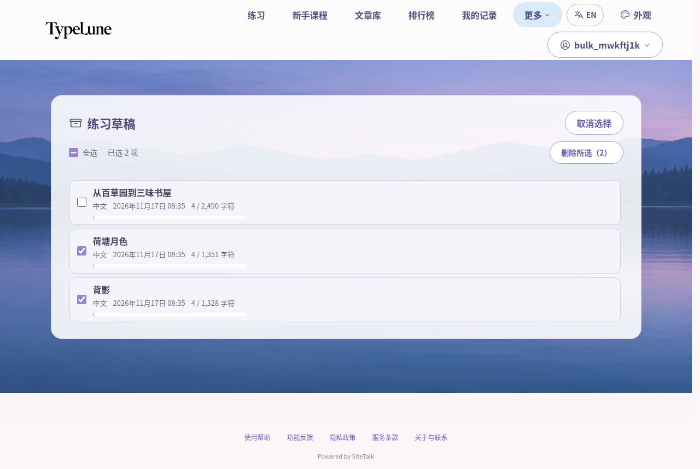
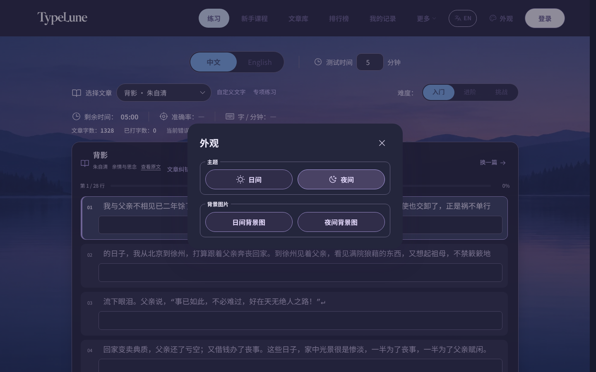
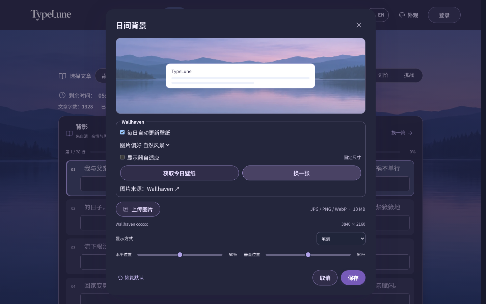
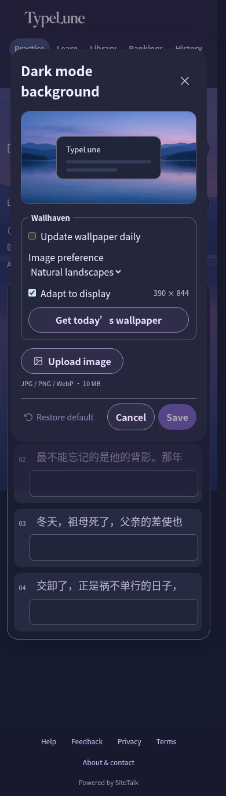

# Appearance, wallpaper selection and draft management

## Behavior

- Drafts support selection mode, select-all, a selected count and one confirmation for batch deletion. Cancel and failed deletion retain the selection. Every selected draft's identity, saved snapshot and local lease are checked before any deletion markers are persisted. Markers are written together before local recovery copies are removed, and synchronize through the existing account workspace. Completed score recovery stays separate.
- The header's former theme button opens Appearance. It contains explicit light/dark theme choices and both background editors. Practice settings no longer duplicate these controls. Existing theme persistence, practice parking and account isolation are preserved.
- The background editor is wider (800 px maximum) with a larger preview, independently scrolling content and always reachable footer actions. Local image selection is labeled Upload image.
- Another wallpaper excludes the current image, prefers unseen candidates and preserves the current preview on failure. Different choices and resolutions have separate bounded caches; the ordinary daily default stays stable.
- Display adaptation is enabled by default and can be disabled separately for each theme. Native target dimensions include device pixel ratio. Adapted responses record their target so automatic updates also respond to display changes. Custom uploads remain protected from automatic replacement. Settings and image changes save together and synchronize to the account.
- Native 4K output is supported. Targets are bounded to 5120 pixels per dimension and 16 million pixels; provider downloads and image processing retain their safety limits. Progressive compression keeps the existing 768 KiB storage limit, reducing resolution only if necessary. The editor reports actual returned dimensions.

The prior [wallpaper timeout fix](2026-11-17-daily-wallpaper-fix.md) is included in the same PR. No database migration is needed.

## Verification

- Full unit/API suite with actual disposable PostgreSQL: **813 passed**, four optional cases skipped.
- TypeScript, production build, four Sites packaging checks and the Vercel NodeNext emitted-function import check passed.
- New browser cases cover confirmed batch deletion, deselection/cancel, deleting the remaining active draft, reload and another independent account device; Appearance/theme grouping; native 4K requests; excluding the current image; persisted adaptation-off preference; English phone layout. Related existing background and delayed 13-second retrieval cases also pass.
- Full SQLite browser regression and PostgreSQL browser regression: final results recorded in the PR after completion.
- Real Wallhaven requests through the updated server returned valid 3840×2160 nature, another different nature image and portrait backgrounds, all HTTP 200 and within the stored image limit.

Screenshots use synthetic test accounts and an existing local landscape image for the deterministic wallpaper UI fixture. Actual provider retrieval was separately verified above.

