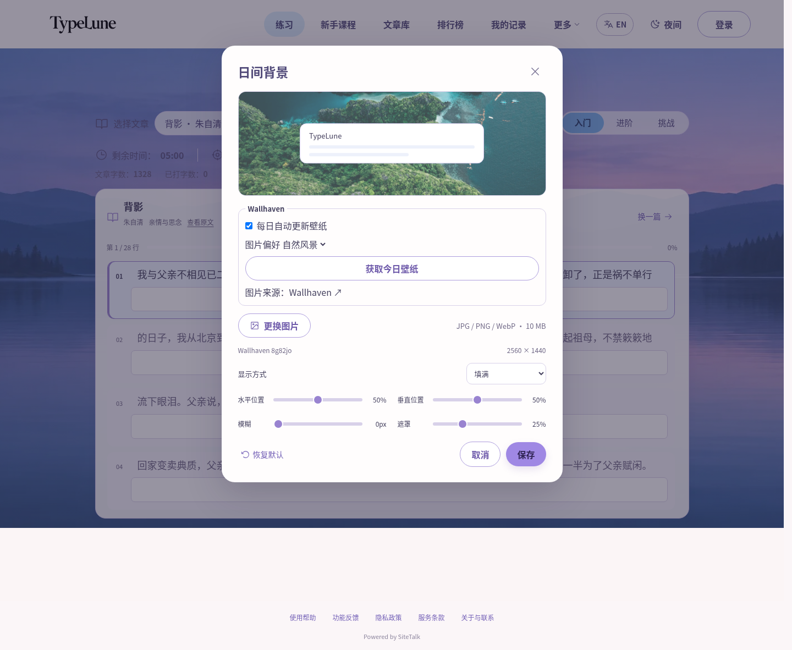

# Daily wallpaper retrieval regression

Both the automatic-update checkbox and manual retrieval used the ordinary 12-second API timeout, while the server allowed 40 seconds for provider requests and image conversion. A cold or slow request could therefore fail in the browser before the server finished. A single broken candidate also stopped the server's search, and a one-minute failure cooldown prevented an immediate successful retry.

The dialog and hourly updater now share a validated wallpaper client with a 55-second timeout. The server enforces a shared 40-second work deadline, continues after an individual detail/download/decode failure, and progressively compresses accepted images within the existing storage limit. Immediate manual retry is allowed. Existing provider allowlists, SFW/portrait filtering, size limits, request rate limiting, daily cache, in-flight deduplication, cancellation, owner checks, and previous-background preservation remain in place. No database changes are required.

## Local verification

- TypeScript check and production build passed.
- Five related unit/API test files: 27 tests passed. Includes delayed client success, explicit cancellation, candidate detail/download/decode failures, immediate retry, malformed/unsafe metadata rejection, saved-background preservation, and persistence rollback.
- Three new Chromium regressions passed with actual 13-second response delays: manual retrieval, automatic-update checkbox, and next-day automatic refresh. The previous image remains visible during refresh; the result survives reload.
- Six existing Chromium background cases passed: real raster uploads, invalid files/cancellation, JPEG/PNG/WebP encoding, mobile/day-night controls, account/device isolation, daily preference synchronization and disabling.
- Sites packaging: four checks passed. Vercel NodeNext emitted-function import check passed.
- Real Wallhaven API through the updated server: nature and portrait both returned HTTP 200 with valid processed backgrounds. A real browser enabled daily updates, retrieved a landscape, saved it, reloaded successfully, and manually retrieved it again with no alerts or page errors.

The real-provider screenshot below shows the accepted landscape and working save controls. Live provider availability can vary; failures preserve the existing background.



## Commands

```sh
npm run typecheck
npm run build
npx vitest run tests/daily-wallpaper-client.test.ts tests/wallpapers-daily.test.ts tests/background-ui.test.tsx tests/wallpaper-save.test.ts tests/background.test.ts --maxWorkers=2
npx playwright test e2e/wallpaper-retrieval.e2e.ts
npx playwright test e2e/background.e2e.ts e2e/profile-layout.e2e.ts --grep 'uploads a real raster|rejects damaged|decodes and stores|keeps phone|syncs the image|daily wallpaper preview'
npm run test:sites
npm run test:vercel-esm
```

GitHub workflow runs are skipped for this branch; verification above was performed locally.
